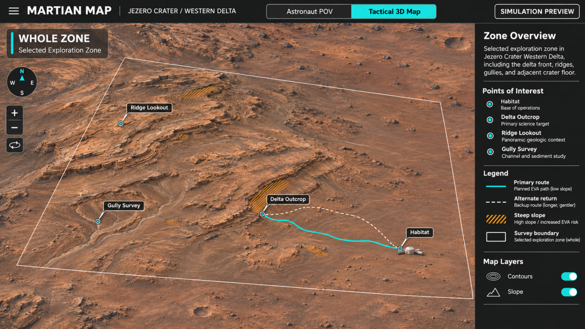
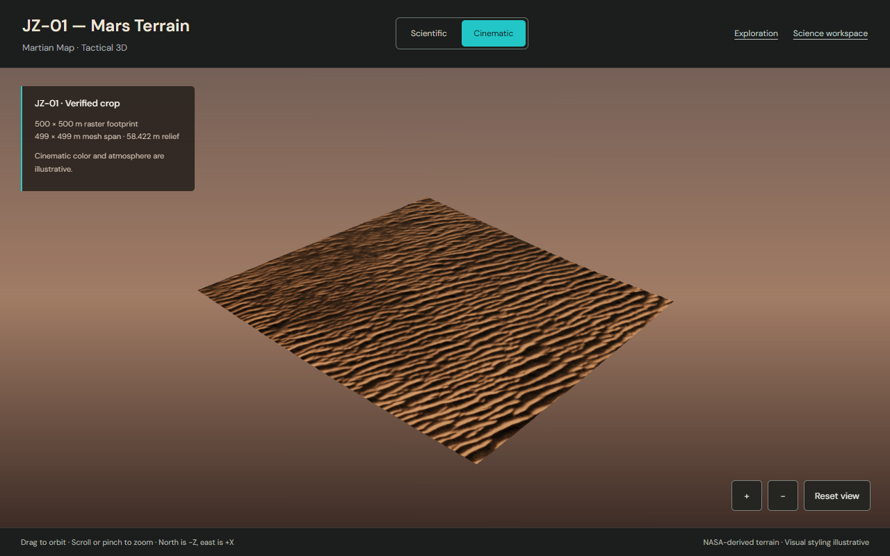
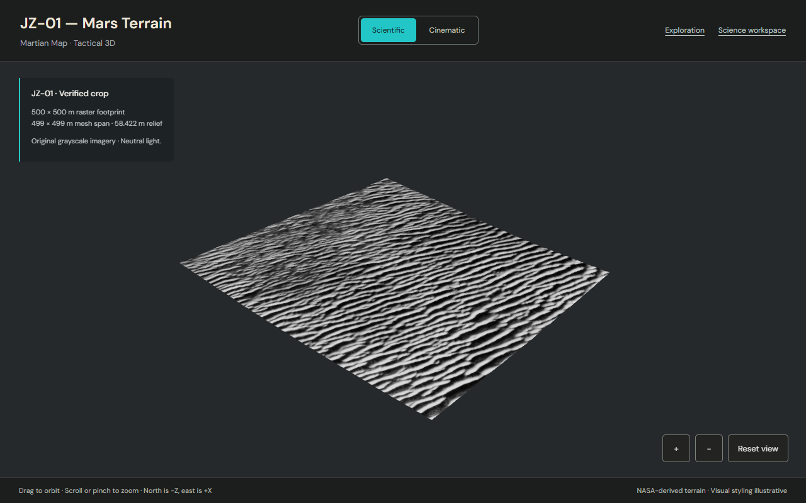
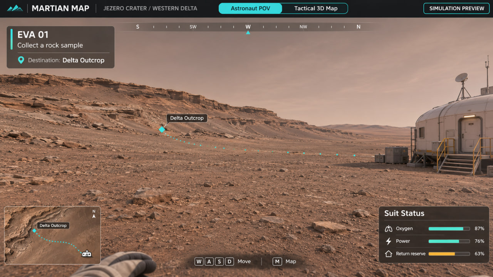

# Step 4 — Cinematic Mars visual design report

**STEP 4 STATUS: PASS**

## Reference inspection and direction

Both original JPGs were opened and visually inspected before implementation: `references/jz01/tactical_3d_map.jpg` (primary) and `references/jz01/astronaut_pov.jpg` (future POV). These are concept-art design references, not scientific evidence. Neither their Western Delta labeling nor their geological/mission landmarks was transferred to JZ-01.

The tactical reference uses dusty copper/ochre illuminated surfaces, deep umber shadow pockets, broad oblique aerial framing, subdued warm atmospheric depth, charcoal UI and selective bright cyan accents. Material response is matte and granular rather than glossy. The astronaut reference adds low eye-level perspective, peach-gray horizon haze and strong foreground-to-distance separation; its habitat, cliff sequence and HUD remain outside this step.

Design palette: charcoal `#1c1e1d`, dusty ochre material multiplier `#cba183`, warm light `#ffdbb4`, dust haze `#ac8165`, dark umber backdrop `#3d2c26`, cyan controls `#22c6c6`. Existing DM Sans remains the UI typeface. Layout keeps a narrow header, compact mode switch, one unobtrusive crop-information block, terrain-focused canvas and camera controls. No mission dashboard or route overlays were added.

## Visual comparison

| Feature | Reference target | Implemented result / deliberate difference |
|---|---|---|
| Surface palette | Muted rusty orange, ochre and brown | Non-destructive dusty-ochre tint and warm light; original grayscale detail stays visible. An initially stronger orange tint was softened after screenshot inspection. |
| Relief and material | Matte granular surface, deep but readable shaded relief | Original geometry/normals, roughness 0.94, metallic 0; no fictional fine-scale displacement or normal detail. Source orbital brightness retains existing shadows. |
| Camera | Broad oblique aerial map composition | Lower oblique default with full-crop framing and smooth reset; camera distance changes on mobile, never terrain scale. |
| Atmospheric depth | Warm dusty distance, softened far surfaces | Light linear distance fog and a presentation-only gradient; no volumetric effects or background mountains. |
| UI | Dark restrained framing and cyan accent | Small dark header, cyan mode selection and crop accent; reference POI/route/sidebar panels intentionally absent. |
| Landscape coverage | Continuous surrounding terrain and large cliffs/ridges | Bounded measured crop remains visibly isolated. Its actual patterns and 58.422 m relief differ from the concept. Matching concept geology would require invented terrain and was not attempted. |
| Astronaut reference | Eye-level terrain, distant horizon, foreground rocks and habitat | Palette/haze cues retained for later work only. No first-person navigation, astronauts, habitats or invented horizon terrain. |

Primary concept reference:



Actual cinematic browser output:



Neutral source-imagery comparison:



Future Astronaut POV reference (not implemented):



## Files and entry

- Modified: `src/jz01/JZ01Preview.tsx`.
- Modified: `src/jz01/jz01.css`.
- Modified: `scripts/jz01/test-runtime.mjs` (reusable Step 4 branch, separate evidence paths).
- Created: `scripts/jz01/test-step4.mjs`.
- Created: `docs/jz01/step4_visual_design_report.md`.
- Created: `docs/jz01/step4-runtime-results.json`.
- Created: `docs/jz01/screenshots/step4_tactical_cinematic.png`.
- Created: `docs/jz01/screenshots/step4_tactical_scientific.png`.
- Created: `docs/jz01/screenshots/step4_tactical_mobile.png`.
- Regenerated build artifacts: `dist/` and `tsconfig.tsbuildinfo`.

Preview: **http://localhost:4173/?workspace=jz01**. Cinematic is the initial mode; Scientific/Cinematic buttons switch presentation in place. Development URL: http://localhost:5173/?workspace=jz01. Existing exploration and science entries remain available. No dependencies were installed.

## Material, lighting and atmosphere

Both modes render one cloned GLB hierarchy sharing the original immutable geometry and texture. Only display materials are cloned; scientific source materials are not mutated. Scientific uses white base-color multiplier, original sRGB image, neutral white ambient intensity 0.8 and white directional intensity 2.1. Cinematic uses `#cba183` material multiplier with the same image, roughness 0.94 and metallic 0.

Cinematic lighting: hemisphere sky `#ecd2b5`, ground `#50372d`, intensity 1.1; directional light at [-280, 240, -400], intensity 3.1, color `#ffdbb4`. ACES filmic tone mapping is applied once by the renderer; exposure 1.2 cinematic / 1.05 scientific. Fog is cinematic-only, color `#ac8165`, near 1050 m, far 4300 m. Neutral mode disables fog.

The background is a 2 × 256 gradient texture with stops `#756057`, `#a17c65` and `#3d2c26`. It is not georeferenced and does not extend the terrain. There are no additional landscape meshes. No postprocessing passes, bloom, volumetrics, displacement, smoothing or shadow-map passes are used. The renderer background adds an internal two-triangle screen quad; it is not a second terrain. Existing orbital shadows are retained; the added light is illustrative and does not establish a measured solar direction.

Display material cleanup disposes only owned cloned materials, not shared geometry/textures. Atmosphere effect cleanup restores background/fog and disposes the owned gradient texture. Listener/readiness callback cleanup is retained. Four repeated Scientific/Cinematic cycles passed renderer texture-count plateau checks; this is a short resource-ownership check, not a long-duration memory certification.

## Camera behavior

Default position [610, 520, 740] m, target [0, 25, 0] m, vertical FOV 35°, near/far 0.5/4000 m. Resize multiplies camera-to-target distance by max(1, 1.12/aspect). Orbit damping is 0.08. Zoom distance is constrained to 520–2600 m and polar angle to 0.12–0.4π radians; the worst permitted camera altitude stays above the highest terrain point.

Reset and zoom buttons interpolate camera position with smoothstep over 0.65 seconds (elapsed increments capped on slow frames). Native pointer or wheel input interrupts the transition and resumes controls. Reduced-motion users receive an immediate reset. Wheel zoom and native touch orbit/pinch remain available through OrbitControls. Camera transitions mutate refs; no per-frame React state updates are used. No POV movement was introduced.

Executed camera evidence: mouse orbit, wheel zoom, zoom buttons, reset intermediate positions, final reset framing, minimum-distance/altitude configuration, reduced-motion reset, demand-render settling, native mobile touch orbit and pinch, and full mobile bounds framing. Screenshots were opened and visually inspected after final production validation.

## Scientific preservation

All 17 original handoff files match the Step 2 hash inventory. The Blender scene and GLB match their unchanged validated hashes. Browser checks compare every source position and every oriented triangle in loaded world space: 63001 source samples, 374356 split exported vertices, 125000 triangles, 1 terrain mesh.

Bounds: min [-249.5, 0, -249.5], max [249.5, 58.42236328125, 249.5] m. Maximum position error 4.999999987e-07 m; UV error 4.386901853e-08. Correct conversion remains `(obj.x, obj.z, -obj.y)`; NW/NE/SW direction fixtures pass. The 499 m sample-center mesh span was not scaled to the 500 m raster footprint.

Both modes were checked to share exact geometry and image objects, unchanged UV registration and world transforms. The cached original material remains white while the display material changes; neutral mode returns to original grayscale without a tinted source cache. No source texture pixels, scientific elevations, UVs or buffer attributes were edited.

## Browser validation and performance

Final production suite: **28/28 PASS**. TypeScript no-emit check PASS, existing unit tests **9/9 PASS**, final production build PASS. Asset-load failure/retry recovery and both existing views also passed. Successful-flow console errors: 0; failed/missing requests: 0. Service workers were blocked during automated tests to keep failure injection deterministic; offline operation was not re-certified.

Commands executed from the workspace:

```powershell
node_modules\.bin\tsc.cmd --noEmit
npm.cmd test
npm.cmd run build
$env:TEST_URL = 'http://localhost:5173'; node scripts/jz01/test-step4.mjs
$env:TEST_URL = 'http://localhost:4173'; node scripts/jz01/test-step4.mjs
```

Tested browser Chrome 157.0.8103.39; actual renderer **ANGLE (Intel, Intel(R) UHD Graphics (0x00004626) Direct3D11 vs_5_0 ps_5_0, D3D11)**.

| Measurement | Step 3 baseline | Step 4 cinematic |
|---|---:|---:|
| Average FPS | 142.36 | 104.59 |
| Mean frame interval | 7.024 ms | 9.562 ms |
| Median frame interval | 6.900 ms | 7.800 ms |
| p95 frame interval | 7.400 ms | 16.900 ms |
| Draw calls | 1 | 2 |
| Submitted triangles | 125000 | 125002 |

Method: six-second warmed continuous OrbitControls auto-rotation, 645 observed frame intervals. Viewport [1280, 800], drawing buffer [1280, 661], actual DPR 1 (configured cap 1.5). The extra two triangles/draw call belong to the background quad. No duplicate terrain, dynamic shadow maps or postprocessing render targets were added.

The measured configuration exceeds 30 FPS. These are CPU-observed headless rendered-frame intervals, not GPU timer or display-presented measurements. Step 4 uses a closer/lower camera, different terrain screen coverage and atmosphere; this historical comparison does not isolate the cost of any individual effect. RTX 2050 was not selected by Chrome; its FPS, real mobile GPU performance, sustained thermal behavior and cold-load time remain unverified.

Nonblocking warnings: Service Worker registration blocked by Playwright; THREE.Clock: This module has been deprecated. Please use THREE.Timer instead.; THREE.WebGLShadowMap: PCFSoftShadowMap has been removed. Using PCFShadowMap instead.. The existing shared Three.js bundle still triggers the Vite >500 kB warning. No significant browser error was observed in successful flows.

## Output screenshots and remaining limits

- `docs/jz01/screenshots/step4_tactical_cinematic.png` — 1280 × 800.
- `docs/jz01/screenshots/step4_tactical_scientific.png` — 1280 × 800.
- `docs/jz01/screenshots/step4_tactical_mobile.png` — 390 × 844.

Step 3 screenshots and runtime-results.json were preserved. Final screenshot review corrected initial oversaturation and mobile edge clipping; final full-crop mobile projection is tested numerically. The visible bounded tile and source-resolution detail differ from the full-landscape concept images. Orbital texture luminance is not calibrated albedo, and illustrative color/haze are not measured Martian weather or surface color. The 2 m visual mesh cannot resolve the sub-meter granular relief seen in the concept; no such relief was invented.

No Step 4 blocker remains. Future work needs separate approval: Astronaut POV camera/ground clearance, navigation, routes and mission UI. The reference habitat, astronauts, fictional POIs and geological formations were not implemented.

| Validation | Status |
|---|---|
| Scientific geometry preserved | PASS |
| Original texture preserved | PASS |
| Cinematic appearance implemented | PASS |
| Lighting and atmosphere | PASS |
| Camera smoothness | PASS |
| Scientific view available | PASS |
| Mobile rendering | PASS |
| Existing views preserved | PASS |
| Browser tests | PASS |
| Performance measured | PASS |
