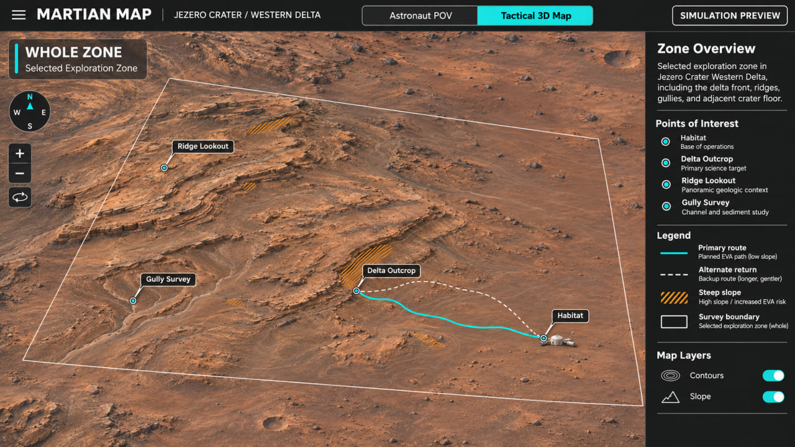
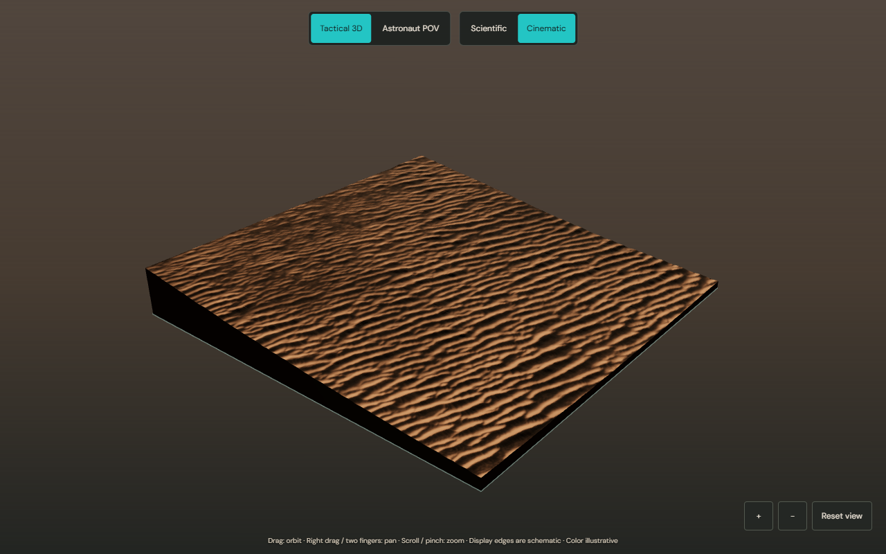
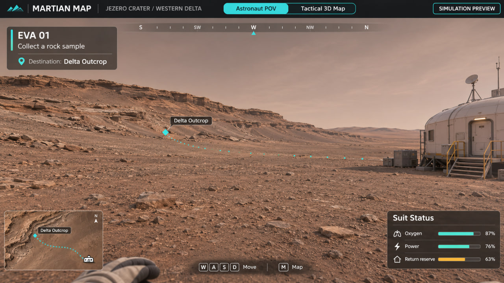
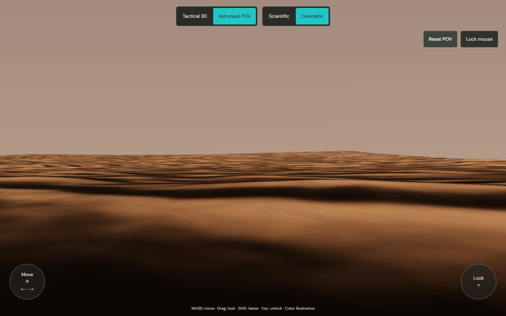

# Step 5 — Complete interactive 3D views

**STEP 5 STATUS: PASS**

This report supersedes the earlier Step 5 implementation report for the latest strict scope: terrain, two interactive views and their camera/view controls only. No Step 6 work was started.

## Open the viewer

**http://localhost:4173/?workspace=jz01**

Use the single **Tactical 3D | Astronaut POV** two-option switch. Views switch in place using one terrain instance and one coordinate system. Scientific/Cinematic presentation remains optional. All information cards, the preview header, workspace-navigation links and footer panels were removed from this viewer. Only view/mode buttons, camera controls, touch controls, operational loading/error states and a small control/schematic-frame hint remain.

## Implemented features

### Tactical 3D

- Original NASA-derived GLB and hierarchy; 500 m raster footprint / 499 m sample-center mesh span, true meter scale.
- Smooth orbit with damping; right-drag and native two-finger pan constrained to the crop target region without height drift.
- Eased wheel zoom (0.28 s), eased zoom buttons/reset (0.65 s), reduced-motion handling and distance/polar-angle limits.
- Reset restores complete overview; zoom keeps a panned target instead of jumping to the center.
- Terrain-first oblique composition, matte warm material, restrained atmosphere, visible finite boundary and diagrammatic display cut edges/base. The base/cut walls are not subsurface geology or surrounding Mars terrain. Scientific view remains neutral.
- Responsive mobile camera fits the actual model bounds and uses a fuller front-facing oblique pose. The complete crop remains visible at overview.

### Astronaut POV

- Approximately 1.7 m clearance above the higher of the actual 1 m DTM and the exact rendered triangle surface, preventing underground camera positions.
- WASD/arrows, camera-relative horizontal movement, eased acceleration/deceleration, mouse drag, optional pointer lock and reliable Escape unlock.
- Independent simultaneous mobile move/look controls; release/cancel and focus-loss clear movement.
- No vertical flying control. Position is clamped 2 m inside the mesh edge (X/Z ±247.5 m). Ground height is recomputed every active frame.
- Natural 60° FOV, 0.08 m near plane, safe ground spawn, mildly downward initial pitch (-0.12 radians), warm illustrative light/haze and no invented horizon landscape.
- Reset POV restores safe spawn and look direction. Tactical/POV switching restores appropriate camera controls; the prior POV ground position/orientation is retained on return.

The DTM and 2 m mesh differ between visual mesh vertices. The floor uses max(DTM, mesh) plus 1.7 m, so clearance above either individual representation can be slightly greater than 1.7 m. This is conservative camera collision, not terrain modification or a claim of sub-meter source accuracy. Collision covers this heightfield and its boundaries; body physics, overhangs, geological hazards and EVA safety are outside scope.

## Clean integration API

Public entry: `src/jz01/MarsTerrainViewer.tsx`. The underlying exported `MarsTerrainViewer` has no router requirement, fills its own parent and does not position itself over teammates’ pages. The standalone JZ-01 preview supplies the viewport-sized parent. No dependencies were added.

```tsx
import MarsTerrainViewer from './jz01/MarsTerrainViewer';

<div style={{ width: '100%', height: 480 }}>
  <MarsTerrainViewer
    initialView="tactical"
    initialMode="cinematic"
    showPresentationControls={true}
    showHints={true}
    onViewChange={view => console.log(view)}
  />
</div>
```

Props also support `assetUrl`, `navigationUrl`, `navigation` (typed mission sampling/spawn contract), `label`, and `className`. For another mission, provide a matching regular-grid navigation contract/data and mount with that mission’s key. Tactical target/framing and display edges derive from actual model bounds. Diagnostic globals default OFF for embedded instances; the standalone demo enables them only for validation.

All viewer CSS rules target the viewer’s own classes. Camera, reset and touch-input events are attached to the owning canvas rather than broadcast through window. POV keyboard input acts only when that viewer owns focus or pointer lock, so another teammate’s focused UI cannot move the astronaut. Cache-owned geometry/textures are shared immutably; only display materials are cloned. Owned presentation resources/listeners are cleaned up.

Browser integration checks verified a 640 × 480 parent container, operation without the optional diagnostic global, focus isolation from an external host button, and restoration of camera controls after repeated switching. Multi-instance stress/long-duration leak testing was not claimed.

## Scientific integrity

Actual loaded world-space bounds: minimum **[-249.5, 0, -249.5]**, maximum **[249.5, 58.42236328125, 249.5]** meters. Correct source conversion remains **(obj.x, obj.z, -obj.y)**.

- All 63001 source vertex positions and 125000 oriented triangles remain equivalent; exported vertex count 374356 includes normal/corner splits.
- Maximum position difference 4.999999987e-07 m; maximum UV difference 4.386901853e-08. NW/NE/SW checks pass.
- Original 2000 × 2000 grayscale texture and original UV registration remain shared by Scientific/Cinematic modes. Illustrative tint changes only cloned display materials.
- All 17 handoff files match the Step 2 hash inventory. Validated GLB and editable Blender scene hashes remain unchanged.
- No geometry smoothing, resampling, displacement, elevation exaggeration, artificial terrain extension or fabricated POI was added.
- The existing `/?workspace=science` Western Delta view is separate and preserved. JZ-01 is not labeled Western Delta.

## References versus actual implementation

Both exact JPG files were opened and inspected again before implementation: `references/jz01/tactical_3d_map.jpg` and `references/jz01/astronaut_pov.jpg`.

| Aspect | Reference | Current implementation / difference |
|---|---|---|
| Tactical composition | Broad oblique aerial terrain, charcoal frame and cyan selector | Terrain fills the viewing area more prominently without data cards; compact cyan two-option view switch and complete mobile crop. |
| Surface / light | Dusty rust/ochre, matte relief and directional shadows | Warm matte tint, directional light, soft fill and neutral Scientific option; original orbital luminance/shadows preserved. Color is illustrative. |
| Finite coverage | Concept shows a continuous surrounding landscape | Measured crop remains a finite technical survey model with identifiable cut edges/base. No surrounding mountains or geology were invented to hide the boundary. |
| POV | Low eye-level perspective, warm haze, rough foreground and distant cliffs | 1.7 m terrain-following perspective, natural FOV and warm haze; actual ripple terrain replaces the concept’s unsupported cliffs. |
| Close-range detail | Detailed rocks, grains, foreground astronaut gear | Original orbital texture becomes blurry and the 2 m mesh can show facets close up. No unmeasured rocks, normal-map relief, astronaut or habitat was fabricated. |
| UI | Concept mission cards, compass, minimap and suit displays | Deliberately omitted. Only the view switch, existing presentation switch and necessary camera/touch controls remain. |

Primary Tactical reference:



Actual Tactical result:



Astronaut reference:



Actual POV result:



## Tests executed

```powershell
node_modules\.bin\tsc.cmd --noEmit
npm.cmd test
npm.cmd run build
$env:TEST_URL = 'http://localhost:4173'; node scripts/jz01/test-step5-complete.mjs
```

**TypeScript PASS; unit tests 12/12 PASS; production build PASS; final production browser checks 53/53 PASS.**

Browser tests verified: both views; exact geometry/scale/orientation/UVs; presentation switching; source-cache preservation; mouse orbit and pan; wheel zoom intermediate distances; reset transition; reduced-motion reset; native touch orbit/pinch; complete mobile crop; simultaneous POV move/look; stop on release; drag-look; pointer lock/Escape; WASD ground following; four boundary corners; underground/flying perturbation correction; safe reset; no-reload switching with retained ground position; focus-loss cleanup; host UI focus isolation; parent-contained embedding; operation without diagnostic global; existing exploration/science views; loading-error/retry recovery; all immutable asset hashes.

Unit coverage includes all original terrain sample vertices, original triangle interior heights, final short edge cells, source sampling bounds and a differently configured mission grid.

Successful-flow console errors: **0**. Missing/failed successful-flow asset requests: **0**. The test intentionally blocks service workers and isolates failed-asset injection in a separate page. Existing nonblocking warnings: Service Worker registration blocked by Playwright; THREE.Clock: This module has been deprecated. Please use THREE.Timer instead.; THREE.WebGLShadowMap: PCFSoftShadowMap has been removed. Using PCFShadowMap instead.. The shared Three.js bundle still emits the existing Vite size warning; no dependency upgrade or unrelated refactor was made.

## Measured performance

Chrome 157.0.8103.39, actual renderer **ANGLE (Intel, Intel(R) UHD Graphics (0x00004626) Direct3D11 vs_5_0 ps_5_0, D3D11)**; viewport 1280 × 800, actual DPR 1 (cap 1.5).

| Workload | Average FPS | Mean frame interval | p95 frame interval | Draw calls |
|---|---:|---:|---:|---:|
| Tactical, warmed 6 s continuous orbit | 113.97 | 8.774 ms | 13.300 ms | 5 |
| POV, warmed 6 s walking | 132.36 | 7.555 ms | 10.800 ms | 2 |

Headless CPU-observed rendered-frame intervals exceed 30 FPS in this run. These are not display-presented/GPU-timer guarantees, an RTX 2050 benchmark, real mobile GPU measurements or sustained thermal tests. The mobile tests emulate touch/viewport on desktop Chrome. Cold-load and long-duration memory behavior remain unverified. There are no new volumetric or postprocessing passes or dynamic shadow maps.

## Screenshot deliverables

| View | Desktop | Mobile |
|---|---|---|
| Tactical 3D | `docs/jz01/screenshots/step5_complete_tactical_cinematic.png` | `docs/jz01/screenshots/step5_complete_tactical_mobile.png` |
| Astronaut POV | `docs/jz01/screenshots/step5_pov_desktop.png` | `docs/jz01/screenshots/step5_pov_mobile.png` |

Neutral Tactical evidence: `docs/jz01/screenshots/step5_complete_tactical_scientific.png`. All four requested desktop/mobile view screenshots were opened and visually inspected. Machine-readable evidence: `docs/jz01/step5_complete-runtime-results.json`.

## Files changed for this completion pass

- `src/jz01/JZ01Preview.tsx` — reusable parent-contained viewer, minimal switches, pan/eased zoom, scoped inputs and bounds-driven cameras.
- `src/jz01/MarsTerrainViewer.tsx` — teammate-facing component/type export.
- `src/jz01/POVCamera.tsx` — focus-scoped input, local events, optional diagnostics and site-change initialization.
- `src/jz01/SurveyFrame.tsx` — model-bounds-derived display framing.
- `src/jz01/navigation.ts` — slightly more ground-focused spawn pitch; scientific heights unchanged.
- `src/jz01/jz01.css` — component-scoped minimal controls, no information-card styling or fixed full-page viewer.
- `scripts/jz01/test-runtime.mjs` and `scripts/jz01/test-step5-complete.mjs` — regressions and new evidence paths.
- This report, `step5_complete-runtime-results.json`, the three new Tactical screenshots and refreshed POV screenshots.
- Generated build artifacts in `dist/` and `tsconfig.tsbuildinfo`.

## Final status

| Validation | Status |
|---|---|
| Tactical orbit, pan, zoom and reset | PASS |
| Interactive desktop/mobile Astronaut POV | PASS |
| Ground following and coverage collision | PASS |
| Minimal in-place two-view switch | PASS |
| Scientific/Cinematic modes | PASS |
| Scientific source integrity | PASS |
| Teammate integration and focused input | PASS |
| Existing application views | PASS |
| TypeScript, unit tests and build | PASS |
| Browser regressions and screenshots | PASS |
| Actual browser FPS recorded | PASS |

No Step 5 blocker remains. Source-resolution blur/faceting and finite coverage are inherent visible limits. No mission UI cards, dashboards, compass, minimap, resources, routes, habitats, astronauts or full helmet HUD were implemented. **Stopped after Step 5; Step 6 was not started.**
