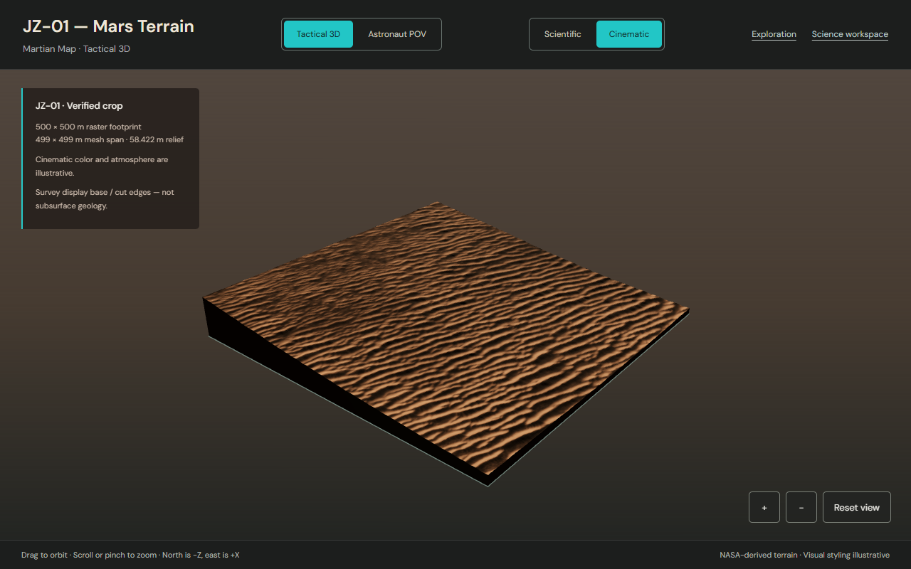
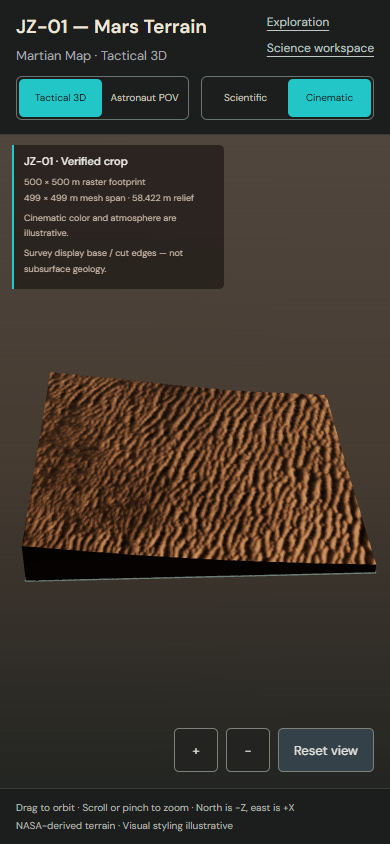
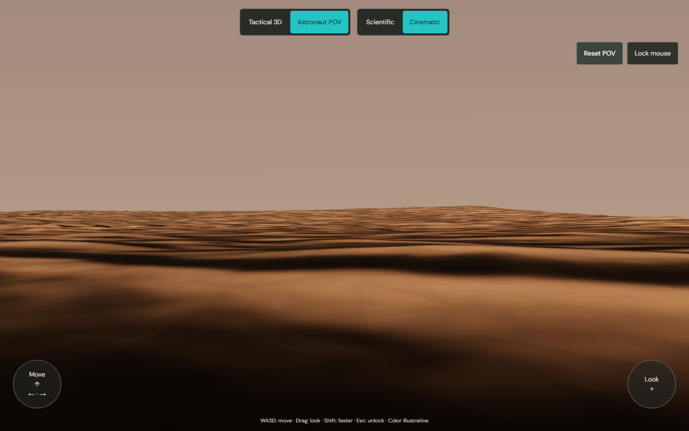

# Step 5 — Interactive Astronaut POV and tactical refinements

**STEP 5 STATUS: PASS**

## Entry and controls

Open **http://localhost:4173/?workspace=jz01**. Use **Astronaut POV** / **Tactical 3D** to switch views. Scientific / Cinematic switches presentation without changing the terrain or the POV position. The existing `/?workspace=science` Western Delta workspace is a separate older dataset/view and was not replaced or relabeled as JZ-01.

- Desktop POV: WASD / arrows move relative to horizontal viewing direction; drag to look, or explicitly select Lock mouse. Escape unlocks and clears movement. Shift selects faster movement. Reset POV returns to the validated spawn.
- Mobile POV: independent movement joystick and look touchpad support simultaneous touches. Releasing/cancelling the movement pointer stops input, then velocity settles. Tactical orbit, native pinch, zoom buttons and animated reset remain available.
- Switching to Tactical returns to its complete overview; switching back to POV restores the previous ground position and yaw/pitch. POV resize preserves the active position. Losing focus clears movement; inactive views cannot keep walking.

## Ground following and collision

`navigation-heights.bin` is a lossless decoded little-endian float32 copy of all 250,000 values in the original 500 × 500, 1 m DTM. `prepare-navigation.py` checks the source SHA-256, dimensions and finite values before copying. `navigation-source.json` records the input provenance, sample-center origin, row order and local elevation offset. The original TIFF remains unchanged.

Coordinates remain Three.js X east / Y up / Z south. Navigation uses the source raster pixel-center transform; local height offset is +2425.92626953125 m. The camera floor combines bilinear 1 m DTM sampling with the exact original 2 m visual-mesh triangle interpolation, including the final 1 m cell and the source triangle diagonal. Eye height is **1.7 m above the higher of those two surfaces**. This prevents the camera entering either the denser scientific DTM or the rendered mesh while preserving both unchanged.

The two surface representations differ slightly between visual mesh samples. A scan at every 1 m DTM center found maximum DTM-above-mesh difference 0.2393798828125 m and mesh-above-DTM difference 0.3353271484375 m. At those sampled centers, clearance above the visible mesh is therefore 1.7–1.9393798828125 m. These numerical representation differences are not evidence of additional geological accuracy.

Movement clamps to X/Z ±247.5 m, providing a 2 m margin inside the ±249.5 m sample-center mesh. Pitch affects only look direction, never flying; every active frame recomputes Y from the terrain. Boundary collision is enforced independently on both axes, including diagonal corner movement. Walking speeds are presentation assumptions: 1.4 m/s, Shift 2.8 m/s; velocity approaches its target exponentially. Delta time is capped at 0.04 s to avoid large jumps after a stalled frame.

Collision scope is a heightfield floor plus horizontal coverage boundaries, appropriate to this single-valued terrain surface. It does not claim full body/capsule physics, overhang collision, hazard detection or EVA safety. No props or obstacles were introduced. Diagnostic placement used for boundary testing accepts only X/Z, clamps them to coverage, and always derives height from the same floor; no user-facing teleport/fly control is present.

## Reuse for future missions

`NavigationConfig` separates mission-specific width, height, spacing, sample origin, vertical offset, mesh sample step, eye height, boundary margin, spawn, and movement speeds from `surfaceAt`, `walkBounds`, `clampPosition` and `POVCamera`. JZ-01 is supplied as `JZ01_NAVIGATION`; another mission can provide a different valid contract and asset buffer and mount the camera with that site. A unit fixture using a different 3 × 3 grid, 5 m spacing, different origin and different eye height passes.

The current sampling adapter supports regular raster meshes with the documented source diagonal and optional short final cells. An arbitrary non-grid/overhanging mesh would require a different collision sampler. The JZ-01 URL, visual branding, source preparation and survey framing remain site-specific integration; this step does not create an unrelated generalized mission platform.

## Tactical refinement 1 — finite terrain presentation

The warm floating backdrop was replaced with a darker coherent charcoal/umber presentation gradient. A separate SurveyFrame component draws dark diagrammatic cut edges from the actual outer mesh samples to a fixed display datum at Y = −8 m, a simple 500 m square display base and a thin raster-footprint outline. The frame is explicitly labeled **not subsurface geology** in the interface. It is hidden completely in POV.

This is a finite survey model presentation, not an added landscape: no terrain outside the crop, invented mountains, geological strata, shadows pretending to be surrounding ground, or source mesh changes. The 499 m sample-center terrain and the 500 m raster footprint remain distinct; the 0.5 m interval at each side is represented only by the display frame. Boundary/cut edges remain visible instead of disappearing into fog. The original terrain remains one mesh inside its unchanged GLB hierarchy.

## Tactical refinement 2 — mobile framing

Mobile now uses a fuller, nearly front-facing oblique camera, instead of the narrow diagonal silhouette. Camera distance is found by projecting the finite model bounding box with a 35° camera and a binary fit, keeping the full footprint within the viewport. Terrain scale stays 1 unit = 1 meter. Mobile header and mode controls share a compact row; crop information and reset remain accessible.

At the same viewport, the projected corner-footprint area increased from **13.50%** of the canvas using the Step 4 pose to **21.20%**, a **57.0% relative increase**. This is projected footprint area, not a claim of larger physical terrain. Full-crop framing is independently checked by projecting all bounding-box corners. Native touch orbit, pinch and reset pass.

## Scientific preservation

Browser world-space comparison: 63001 original sample positions, 374356 split exported vertices and 125000 oriented triangles remain equivalent. Bounds min [-249.5, 0, -249.5], max [249.5, 58.42236328125, 249.5] m. Maximum position difference 4.999999987e-07 m; maximum UV difference 4.386901853e-08. NW/NE/SW orientation tests pass.

Both presentation modes share identical terrain buffers, source image, UVs and world transforms. All 17 original handoff files match the Step 2 SHA-256 inventory. The validated `terrain.glb` and `JZ01_terrain_scene.blend` match their prior hashes. No source textures, geometry, scale, elevations, scientific coordinate conventions or Blender scenes were modified. No other Mars dataset or existing view was overwritten.

## Validation executed

Final production browser suite: **45/45 PASS**. TypeScript no-emit PASS; unit tests **12/12 PASS**; production build PASS.

New unit coverage: all 63,001 original mesh vertices match collision heights; 635 original triangle centroids validate source topology interpolation; outside coverage is rejected; a distinct mission grid verifies reusable coordinates/eye height and four-edge clamps. Existing nine tests remain passing.

Browser coverage includes ground clearance, mouse-look, explicit pointer-lock entry, Escape release, WASD movement/release, simultaneous mobile movement/look/release, all four boundary corners with actual movement attempts, forced underground/flying camera correction, POV reset, view/presentation switching, focus-loss cleanup, mobile bounds/framing, camera regression tests, original-asset hashes, both existing views and error/retry recovery. Pointer-lock release initially depended on browser default Escape handling; an explicit application handler was added and verified in both a targeted test and the final complete suite.

Successful-flow console errors: **0**. Missing/failed successful-flow asset requests: **0**. Error injection was isolated to a separate page. Nonblocking warnings: Service Worker registration blocked by Playwright; THREE.Clock: This module has been deprecated. Please use THREE.Timer instead.; THREE.WebGLShadowMap: PCFSoftShadowMap has been removed. Using PCFShadowMap instead.. Service workers were blocked by Playwright for deterministic network/error tests; offline behavior is not re-certified here. The existing shared Three.js build chunk continues to produce a nonblocking size warning.

Commands:

```powershell
python -B scripts/jz01/prepare-navigation.py
node_modules\.bin\tsc.cmd --noEmit
npm.cmd test
npm.cmd run build
$env:TEST_URL = 'http://localhost:4173'; node scripts/jz01/test-step5.mjs
```

## Measured performance

Chrome 157.0.8103.39; renderer **ANGLE (Intel, Intel(R) UHD Graphics (0x00004626) Direct3D11 vs_5_0 ps_5_0, D3D11)**. Desktop viewport 1280 × 800; actual DPR 1, configured cap 1.5.

| View / workload | Mean FPS | Mean frame interval | p95 frame interval | Draw calls | Submitted triangles |
|---|---:|---:|---:|---:|---:|
| Tactical, warmed 6 s continuous orbit | 106.54 | 9.386 ms | 20.500 ms | 5 | 127004 |
| POV, warmed 6 s continuous walking | 90.03 | 11.107 ms | 25.200 ms | 2 | 125002 |

The extra Tactical draw calls/triangles are diagrammatic framing, raster outline and the background quad; no duplicate scientific terrain is rendered. POV hides the framing. No new postprocessing or dynamic shadow maps were added. Demand rendering settles when idle; per-frame camera updates use refs, not React state.

These are short headless CPU-observed rendered-frame measurements, not display-presented FPS guarantees or GPU timer queries. Chrome selected Intel UHD, not RTX 2050. Actual mobile GPU/thermal performance, sustained long-session performance and cold-start measurements remain unverified. Touch tests emulate mobile input in desktop Chrome.

## Screenshots and comparison

- `docs/jz01/screenshots/step5_tactical_cinematic.png` — updated desktop Tactical.
- `docs/jz01/screenshots/step5_tactical_scientific.png` — updated neutral Tactical.
- `docs/jz01/screenshots/step5_tactical_mobile.png` — complete, larger mobile Tactical footprint.
- `docs/jz01/screenshots/step5_pov_desktop.png` — ground-level desktop POV.
- `docs/jz01/screenshots/step5_pov_mobile.png` — mobile POV and separate touch controls.

All five screenshots were captured from the application. Desktop Tactical, mobile Tactical, mobile POV and desktop POV were opened and visually inspected. Source-resolution blur and broad orbital shadow patterns remain visible near eye level; these are limitations of original imagery/mesh resolution. Reference concepts contain finer ground details, cliffs and habitats that were not invented to hide those limits. Earlier Step 3/4 screenshots/reports remain preserved.







## Files created or modified

- Modified: `src/jz01/JZ01Preview.tsx`, `src/jz01/jz01.css`, `scripts/jz01/test-runtime.mjs`.
- Created: `src/jz01/POVCamera.tsx`, `src/jz01/SurveyFrame.tsx`, `src/jz01/navigation.ts`.
- Created: `scripts/jz01/prepare-navigation.py`, `scripts/jz01/test-step5.mjs`, `tests/jz01-navigation.test.ts`.
- Created: `public/assets/mars/jz01/navigation-heights.bin`, `public/assets/mars/jz01/navigation-source.json`.
- Created: this report, `docs/jz01/step5-runtime-results.json`, and the five screenshot files listed above.
- Generated: production `dist/` artifacts and `tsconfig.tsbuildinfo`.

## Status and remaining scope

No Step 5 blocker remains. There are no routes, oxygen/battery calculations, emergencies, habitats, astronauts or full helmet HUD. The existing separate Western Delta scientific workspace is unchanged. Dataset vertical/absolute accuracy is limited to the supplied source; navigation behavior is an educational visualization, not certified EVA traversability.

| Validation | Status |
|---|---|
| NASA source, GLB, Blender scene, scale and coordinates preserved | PASS |
| Terrain-aware approximately 1.7 m eye height | PASS |
| Ground, flying and coverage collision constraints | PASS |
| WASD / mouse / pointer-lock / reset | PASS |
| Mobile movement and look | PASS |
| Tactical / POV and Scientific / Cinematic switching | PASS |
| Finite tactical presentation, boundary explicit | PASS |
| Larger complete mobile overview | PASS |
| Reusable mission sampling/configuration | PASS |
| Existing views preserved | PASS |
| TypeScript, unit tests, build and browser regressions | PASS |
| Desktop / mobile screenshots | PASS |
| Actual browser performance measured | PASS |

**Stopped after Step 5.**
